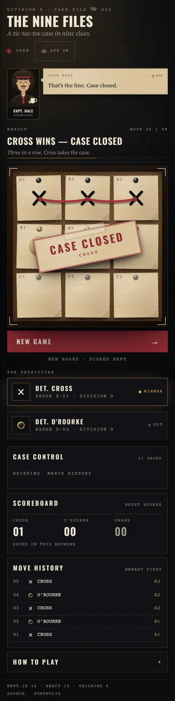

<div align="center">

# THE NINE FILES

### A tic-tac-toe case in nine clues.

Two players, nine cards, one wall.

[Source](https://github.com/Calfredo23/nine-files)


</div>

## What this is

Built for the SUpost / CapM junior React + Next.js application test. The brief asks
for a working two-player tic-tac-toe on a public Vercel URL and says style and
personality count. This is the version I built.

It does the required things first:

- Two players alternate. Cross plays X, O'Rourke plays O.
- The result is explicit: `CROSS WINS — CASE CLOSED` or `DRAW — COLD CASE`.
- New Game clears the board and keeps the scores.
- The scoreboard counts wins and draws and survives a reload.
- Every finished game is saved in the browser and listed under **MATCH HISTORY**.
- **NEW GAME** sits in the **CASE CONTROL** panel on the right, so it is always in reach
  on desktop.
- First-time visitors get a three-beat briefing from Capt. Hale. Replay it from
  **BRIEFING**.

The game is readable without the theme: the cells show X and O, the main button says
NEW GAME, and the result says WINS or DRAW.

## The board and the captain

The board is a cork case wall. Each square is a pinned evidence card. X is a black
marker tag; O is a brass monocle. The winning line is red yarn pulled from card to
card. A taped CASE CLOSED label lands on the board, and the winner's ID card is marked.

A captain, **Capt. Hale**, watches from the corner. After every move he calls it:
best, good, inaccuracy, mistake, or blunder, and says why. The grade is real: the
coach runs a full minimax evaluation plus threat detection, so it can tell a fork from
a wasted edge. The note reveals while he talks.

The first visit opens with a three-beat briefing: the captain sets up the Halver case,
names the two detectives, and explains the one rule. Skip it or replay it from
**BRIEFING** in the CASE CONTROL panel. Finished games are recorded in the browser and
listed under **MATCH HISTORY** (the last 25).

The palette is charcoal, manila, tungsten, and oxblood. The type is Oswald, Source
Serif 4, and Courier Prime. Textures, cards, pins, the monocle, and the captain are CSS
and inline SVG; the app ships no image assets.

## Stack

Next.js 16.4 (App Router), React 19.3, TypeScript, and Tailwind CSS 4. No animation
library: CSS keyframes, transitions, and one canvas burst. No backend, no accounts, no
analytics.

## Quality gates

All numbers below are from the production build on this machine.

| Gate | Result |
|---|---|
| Unit tests (Vitest) | **36 passing** — every win line, draw, illegal move, reset, minimax grade, and history parser |
| E2E (Playwright) | **18 passing** — alternation, win, draw, New Game, persistence, keyboard, briefing, history, coach, no-scroll desktop |
| axe (WCAG 2.1 A/AA) | **0 violations** on the opening screen and after a win |
| Contrast (`scripts/contrast.mjs`) | Every measured pair passes |
| Lighthouse | **100 accessibility · 100 best practices · 100 SEO** on every run; performance 74–99 desktop and 74–92 mobile across repeated runs on a busy host |
| Production build | Static `/`, `/icon.svg`, `/opengraph-image`; no console errors |
| Desktop fit | No page scroll at 1440×900, 1366×768, 1280×800, or 1024×768 |

Measured contrast (WCAG 2.x relative luminance):

| Pair | Ratio | Minimum |
|---|---|---|
| PAPER on INK | 15.77:1 | 4.5 |
| INK on MANILA | 11.36:1 | 4.5 |
| TUNGSTEN on INK | 9.02:1 | 4.5 |
| SMOKE on COAL | 6.07:1 | 4.5 |
| PAPER on OXBLOOD | 6.65:1 | 4.5 |
| COLD on MANILA | 5.45:1 | 4.5 |
| OXBLOOD on MANILA | 4.79:1 | 4.5 |
| MANILA on CORK | 4.53:1 | 3.0 (non-text) |

## Accessibility

- The board is a real grid. Arrows move focus, Home and End jump, and Enter or Space
  plays.
- Turns and the result are announced. Focus moves to the result when the game ends.
- The captain's note is announced; the portrait is decorative and hidden from assistive
  tech.
- The briefing and match history are native dialogs: focus is trapped, Escape closes
  them, and the page behind is inert.
- Focus rings are visible, tap targets are at least 44px, and the layout fits 360, 390,
  768, and 1440 widths.
- Reduced motion removes the shake, flash, paper burst, grain drift, rain, lamp
  flicker, captain's mouth, note reveal, and mark animation.
- X and O differ by shape and material, not only colour. Sound is optional and never
  blocks play.
- Contrast is measured, not eyeballed.

## Run it

```bash
npm install
npm run dev          # http://localhost:3000
npm test             # unit
npm run test:e2e     # Playwright + axe + screenshots
npm run verify       # typecheck + lint + unit + build
```

The Playwright run builds and starts the production server on port 3211. Screenshots
land in `submission/screenshots/`.

## Structure

```
app/                 layout, page, metadata, OG image, icon, 404
components/          board, cells, marks, yarn, stamp, captain, coach, dialogs, ledger
hooks/               game coach, match history, score, and sound preference
lib/                 pure game logic, minimax coach, history, storage, sound
tests/unit/          Vitest
tests/e2e/           Playwright, axe, screenshot capture
scripts/             contrast measurement, WebP optimisation
docs/velitaxis/      project state and the design contract
```

## Decisions and limits

- **No AI opponent.** The brief asks for two players, so the game stays two-player. The
  coach is analysis, not an opponent: it grades moves and never plays one. A minimax
  opponent is the next feature, not a hidden default.
- **Scores and history are local.** `localStorage` only: no account, no leaderboard,
  no personal data. The match log keeps the last 25 games; **RESET SCORES** clears the
  counts and the log. The briefing is marked seen per browser and can be replayed.
- **Animation is CSS-led.** Keyframes and transitions, at most 44 particles, and a
  complete reduced-motion path. There is no animation library in the bundle.
- **No third-party art.** Textures, cards, pins, the monocle, and the captain are CSS
  or SVG.
- **The screenshots are from the production build.** They are regenerated by the
  Playwright screenshot test.

## Screenshots

| Briefing | Match history |
|---|---|
|  |  |

| Desktop | Tablet |
|---|---|
|  |  |

| Mobile | Mobile win |
|---|---|
|  |  |

---

Built by **Cedrick Alfredo Catimbang** · [calfredo.is-pinoy.dev](https://calfredo.is-pinoy.dev)
