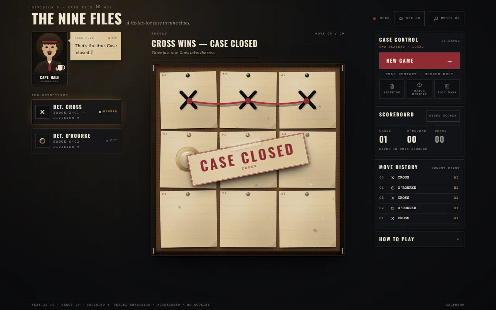
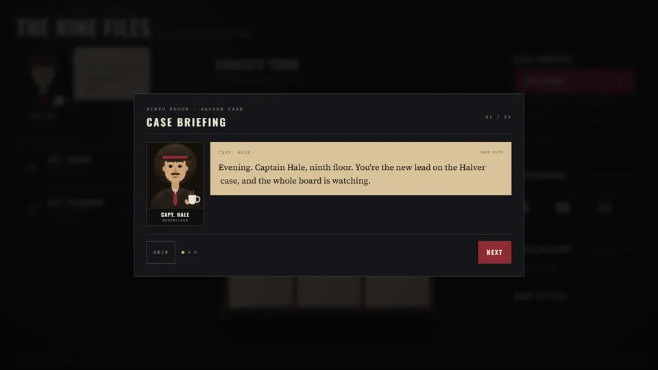
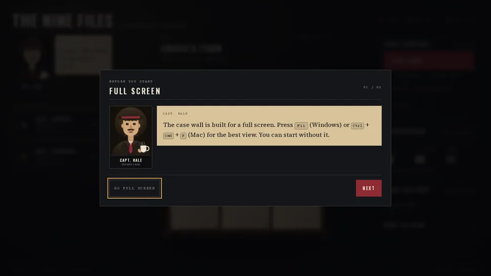
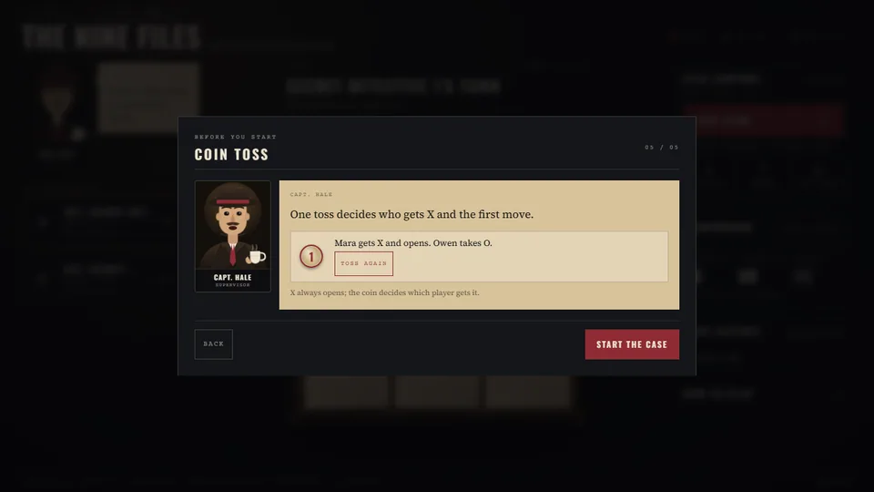
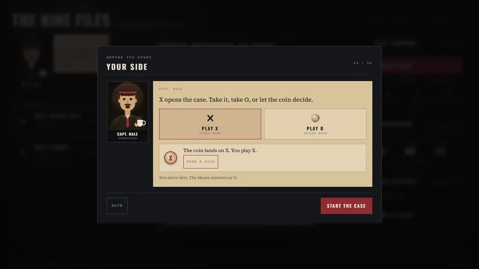
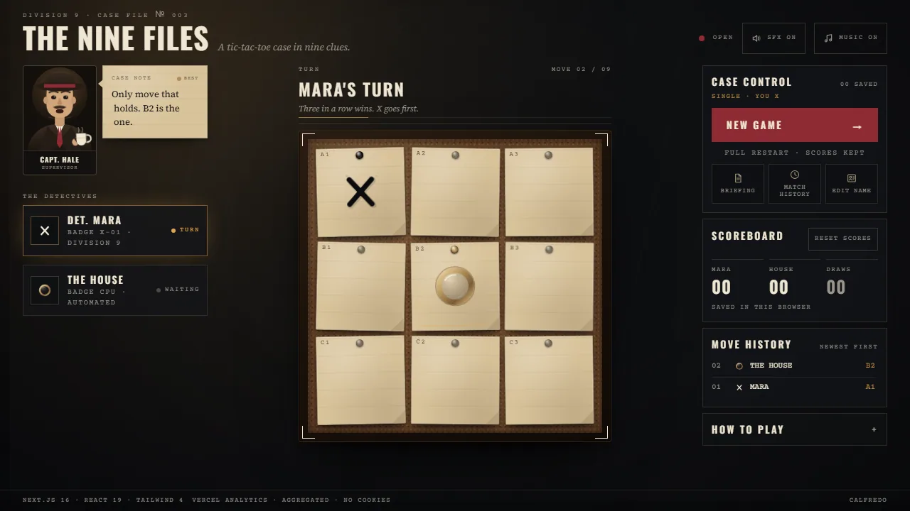
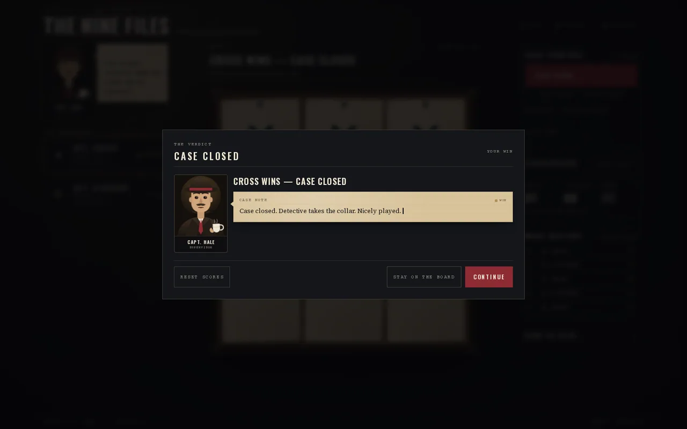
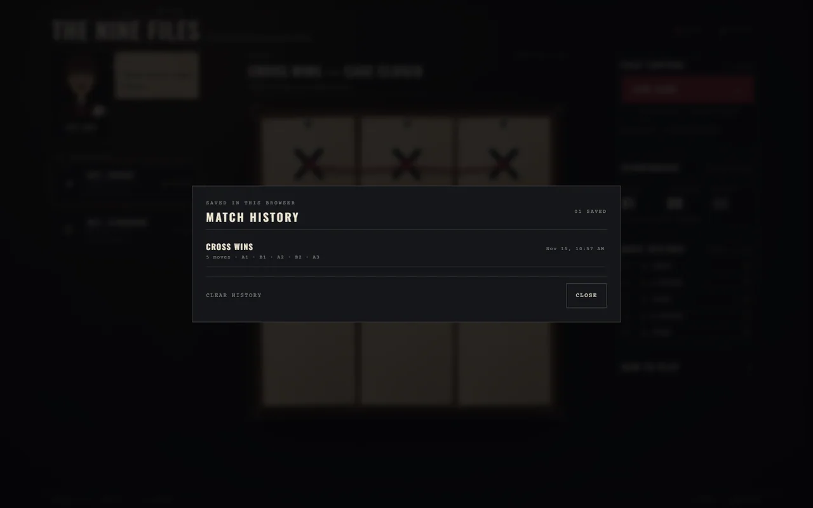
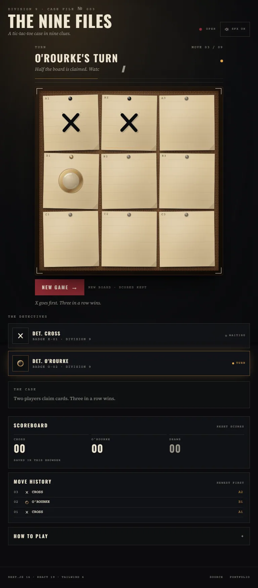

<div align="center">

# THE NINE FILES

**A noir tic-tac-toe case in nine clues.**

One case. Two ways to play. Nine cards.

[**Play the live game**](https://the-nine-files.vercel.app) · [Source](https://github.com/Calfredo23/the-nine-files)

[](https://github.com/Calfredo23/the-nine-files/actions/workflows/ci.yml)
[](https://nextjs.org)
[](https://react.dev)
[](https://www.typescriptlang.org)
[](https://tailwindcss.com)
[](LICENSE)



</div>

## Overview

The Nine Files is a tic-tac-toe game dressed as a detective's case wall.
Two named detectives claim nine pinned cards, or you can take the case solo against the
House. In two-player mode, both names are entered and a coin toss assigns X and the
opening move. Three in a row closes the case; a captain grades every move, red yarn marks
the winning line, and a taped verdict lands on the board.

It was built for the **SUpost / CapM junior React + Next.js application test**. The test
asks for a working two-player game on a public Vercel URL. This is the version I
submitted, with a solo mode added on top.

The required behaviours come first and are literal:

- Two named players alternate. A coin toss assigns **X** and the first move; **O** follows.
- Blank names become **Secret Detective 1** and **Secret Detective 2** in two-player mode,
  or **Secret Detective** in solo mode.
- The result is announced by winner name with **CASE CLOSED**, or **DRAW — COLD CASE**.
- **NEW GAME** starts a fresh case and returns to the briefing and setup.
- The scoreboard counts wins and draws and survives a reload.

The theme never hides the rules: the cells show X and O, the primary button says NEW
GAME, and the result says WINS or DRAW.

## Modes

| Mode | How it works |
|---|---|
| **Two players** | Enter both names, then toss to decide who gets X and opens. The other player takes O. |
| **Single player** | Pick X, pick O, or toss the coin. The other side is **THE HOUSE**, a local minimax opponent that waits about 700 ms, shows **THINKING**, and locks the board while it moves. |
| **Coin toss** | A short CSS flip with a dedicated metallic SFX. In two-player mode it assigns X and the opening move; in solo it picks your side. The result is announced before you start. |

The House is not unbeatable. It plays the best move most of the time, with a deliberate
15% chance to choose a weaker legal move, so a careful player can create a fork and win.

## Features

| | |
|---|---|
| **First-visit briefing** | Capt. Hale sets up the case in three beats. Skippable, replayable. |
| **Full-screen setup** | A pre-game prompt recommends F11 (or Ctrl+Cmd+F), asks for player one’s name, then the mode. Two-player mode asks for player two’s name and tosses to assign X. |
| **Personalized sides** | Both names follow their assigned marks through the cards, turn banner, result, stamp, scoreboard, coach, and history. |
| **Local opponent** | Solo mode adds THE HOUSE: minimax, a short thinking beat, a locked board, and a CPU badge. |
| **Coin toss** | Pick X or O by hand, or let the coin decide with an animated flip and a metallic SFX. |
| **Move coach** | Every move is graded best / good / inaccuracy / mistake / blunder using minimax plus threat and fork detection. |
| **Post-match verdict** | 1.6 s after the result, the captain takes over with CONTINUE, TRY AGAIN, ONE MORE, STAY ON THE BOARD, and RESET SCORES. |
| **Saved history** | Every finished game persists in the browser with winner name, move list, and date. |
| **Full restart** | **NEW GAME** returns to the briefing, full-screen prompt, both names, mode, and the toss/side, and resets the scoreboard. Match history stays until **CLEAR HISTORY** in the history dialog. |
| **Sound** | A procedural noir loop and a soft per-word voice, plus pin, stamp, paper, win, draw, and coin cues. MUSIC and SFX toggle independently and default on. |
| **Analytics** | Vercel Web Analytics reports aggregated page views, referrers, and coarse device/browser/location metrics. Vercel states it uses no cookies and collects no personal identifiers. |
| **Desktop fit** | The whole game fits one screen at 1440×900, 1366×768, 1280×800, and 1024×768 with no page scroll. |
| **Accessibility** | Keyboard play, focus management, native dialogs, reduced-motion support, measured contrast. |

## Screenshots

| Case briefing | Full-screen and player one name |
|---|---|
|  |  |

| Two-player names and first-player toss |
|---|
|  |

| Mode, side, and coin toss | Solo against the House |
|---|---|
|  |  |

| Post-match verdict | Match history |
|---|---|
|  |  |

| Desktop board and Case Control | Tablet |
|---|---|
|  |  |

| Mobile | Mobile win |
|---|---|
|  |  |

## How it plays

1. Read the briefing, then enter player one’s name. Choose **TWO PLAYERS** or **SINGLE
   PLAYER**. In two-player mode, enter player two’s name and toss to decide who gets X
   and opens. In solo, pick X or O (or toss); X always opens. Blank names get Secret
   Detective labels.
2. Take turns claiming cards. Three in a row — across, down, or diagonally — closes the
   case. In solo the board locks while **THE HOUSE** thinks.
3. The turn banner shows whose move it is. The move history lists every clue by name.
4. After the result, the captain offers CONTINUE after your win, TRY AGAIN after a loss,
   or ONE MORE after a draw. That button starts a quick rematch with the same mode and
   side.
5. **NEW GAME** is always in the top-right CASE CONTROL panel. It restarts the experience
   from the briefing, full-screen prompt, both names, mode, and toss/side, and resets the
   scoreboard. Every finished match stays; **CLEAR HISTORY** in the history dialog removes
   them, while **RESET SCORES** only zeros the scoreboard.

## The coach

Capt. Hale is not a random line generator. Every move is evaluated with minimax values
plus immediate threat detection, so the grade reflects the position:

- **Best** — the move holds a forced win, blocks a live line, creates a fork, or is the
  only move that draws.
- **Good** — a sound centre, corner, or neutral move that keeps the position level.
- **Inaccuracy** — an edge that does less than the centre.
- **Mistake** — a better move was available, often a missed win.
- **Blunder** — the move loses the position or leaves a winning line open.

The note reveals word by word while the captain animates. After the result he speaks
again on the verdict screen.

## Sound

The score is a procedural noir loop: Am7 / Dm7 / E7 pads, an upright-style bass, brushed
noise, a sparse bell, and faint vinyl ticks. Capt. Hale's subtitles get a soft per-word
voice blip. There are no audio files; everything is synthesized with the Web Audio API.

**MUSIC** and **SFX** are independent toggles in the header, both on by default and both
persisted. Browsers block audio until a user gesture, so the loop and voice start on the
first click, tap, or key press.

## Tech stack

| Layer | Choice |
|---|---|
| Framework | Next.js 16.4 (App Router, static page) |
| UI | React 19.3, TypeScript strict |
| Styling | Tailwind CSS 4 with a small custom token layer |
| Motion | CSS keyframes and transitions; one canvas paper burst |
| Audio | Web Audio API synthesis; no audio files |
| Analytics | Vercel Web Analytics; aggregate metrics, no cookies |
| Tests | Vitest, Playwright, axe-core |
| Hosting | Vercel |

No game backend, database, accounts, or cookie-based tracking.

## Quick start

```bash
git clone https://github.com/Calfredo23/the-nine-files.git
cd the-nine-files
npm install
npm run dev
```

Open [http://localhost:3000](http://localhost:3000). Click once on the page so the
browser permits audio.

### Scripts

| Command | What it does |
|---|---|
| `npm run dev` | Start the development server |
| `npm run build` | Production build |
| `npm run start` | Serve the production build |
| `npm run typecheck` | `tsc --noEmit` |
| `npm run lint` | ESLint |
| `npm test` | Vitest unit tests |
| `npm run test:e2e` | Playwright, axe, and screenshot capture |
| `npm run verify` | typecheck + lint + unit + build |

The Playwright suite builds and serves the production app on port 3211.

## How it works

- **Pure game logic** lives in `lib/game.ts`: board type, win lines, outcome detection,
  and a tested reducer.
- **The coach** lives in `lib/coach.ts`: minimax values, immediate threats, forks, and
  move grades.
- **The House** lives in `lib/bot.ts`: the same minimax values, a short list of equally
  best moves, and a deliberate 15% mistake rate.
- **Persistence** is localStorage through `useSyncExternalStore`: ledger, 25-match
  history, detective name, mode and side, briefing/setup flags, music, and SFX. There is
  no game backend. Vercel Web Analytics separately receives page-view metrics.
- **Dialogs** are native `<dialog>` elements for the briefing, setup, match history, and
  post-match verdict; the browser supplies the focus trap and inert background.
- **Animation** is CSS; the paper burst is the only canvas.
- **Audio** is a small scheduler in `lib/sound.ts` using oscillators, filtered noise, and
  gain envelopes.

## Quality

| Gate | Result |
|---|---|
| Unit tests (Vitest) | **61 passing** — game, minimax coach, bot, players, settings, history |
| E2E (Playwright) | **31 passing** on Ubuntu CI — game, briefing, setup/names, coin-assigned player order, solo, bot turns, coin toss, restart, history, coach, post-match, reset, audio toggles, axe, no-scroll desktop, screenshots |
| Accessibility | **0 axe violations** on the opening screen, win, briefing, setup, solo side step, and post-match verdict |
| Contrast | every measured pair passes WCAG AA (`scripts/contrast.mjs`) |
| Lighthouse | 100 accessibility, best practices, and SEO; performance 74–99 desktop and 74–92 mobile across repeated runs on a busy host |
| Desktop fit | no page scroll at 1440×900, 1366×768, 1280×800, or 1024×768 |

The Lighthouse numbers were measured before the briefing, setup, history, and
post-match additions; those add a small amount of markup and localStorage reads. The
axe and Playwright gates run on every push.

## Accessibility

- The board is a real ARIA grid: arrows move focus, Home/End jump, and Enter or Space
  plays.
- Turns and the result are announced; focus moves to the result when the game ends.
- The briefing, setup, history, and verdict are native dialogs with focus traps, Escape
  to close, and an inert page behind.
- Focus rings are visible, tap targets are at least 44px, and the layout fits 360, 390,
  768, and 1440 widths.
- Reduced motion removes shake, flash, particles, grain drift, rain, lamp flicker,
  captain motion, subtitle reveal, the coin flip, and the blinking cursor.
- X and O differ by shape and material, not only colour.
- Mode and side are radio groups with visible selection, and the coin result is announced
  in a live region.
- Music and SFX are separate labelled toggles; nothing autoplays before a gesture.

## Deployment

The app is a static Next.js page, deployed on Vercel.

```bash
npx vercel --prod
```

Set `NEXT_PUBLIC_SITE_URL` to the production URL if it differs from
`https://the-nine-files.vercel.app`; it feeds the canonical URL and the OG image metadata.

The root layout includes Vercel's `<Analytics />` component in production only; localhost
and preview builds do not request the Vercel endpoint. Enable **Web Analytics** in the
Vercel project dashboard; collection and reporting start after the next deployment.
Current Vercel documentation lists 50,000 included events/month on Hobby. Pro usage is
metered, so check the project's plan before enabling collection.

## Project structure

```text
app/                    layout, page, metadata, OG image, icon, 404
components/             board, cells, marks, yarn, stamp, captain, coach, dialogs, ledger
hooks/                  coach, history, detective name, settings, music/SFX preferences, speech
lib/                    game logic, minimax coach, House bot, settings, history, storage, Web Audio, stores
tests/unit/             Vitest
tests/e2e/              Playwright, axe, screenshot capture
scripts/                contrast measurement, WebP optimisation
docs/velitaxis/         build state, design contract, measurements
submission/             reviewer notes and demo script
```

## Notes and limits

- **The House is local.** It runs the same minimax evaluation as the coach, in the
  browser, with no network call. It is intentionally imperfect so solo play stays
  winnable; the two-player mode remains the literal version of the brief.
- **Game data stays local.** Scores, history, name, mode, and preferences live in
  localStorage; there is no account or leaderboard.
- **Analytics is separate.** Vercel Web Analytics reports aggregated page views,
  referrers, and coarse location/OS/browser metrics. Vercel states it uses no cookies and
  collects no personal identifiers; visitor recognition uses a hash of request data.
  The app sends no custom events. Analytics must be enabled in the Vercel dashboard.
- **No third-party art or audio.** Textures, cards, pins, the monocle, and the captain
  are CSS or SVG. The music and voice are synthesized.
- **The screenshots are generated by the Playwright suite** from the production build.
- **Audio requires a gesture.** Browsers block autoplay; the first click starts the
  score. MUSIC and SFX can be turned off at any time.

## License

[MIT](LICENSE) © Cedrick Alfredo Catimbang
