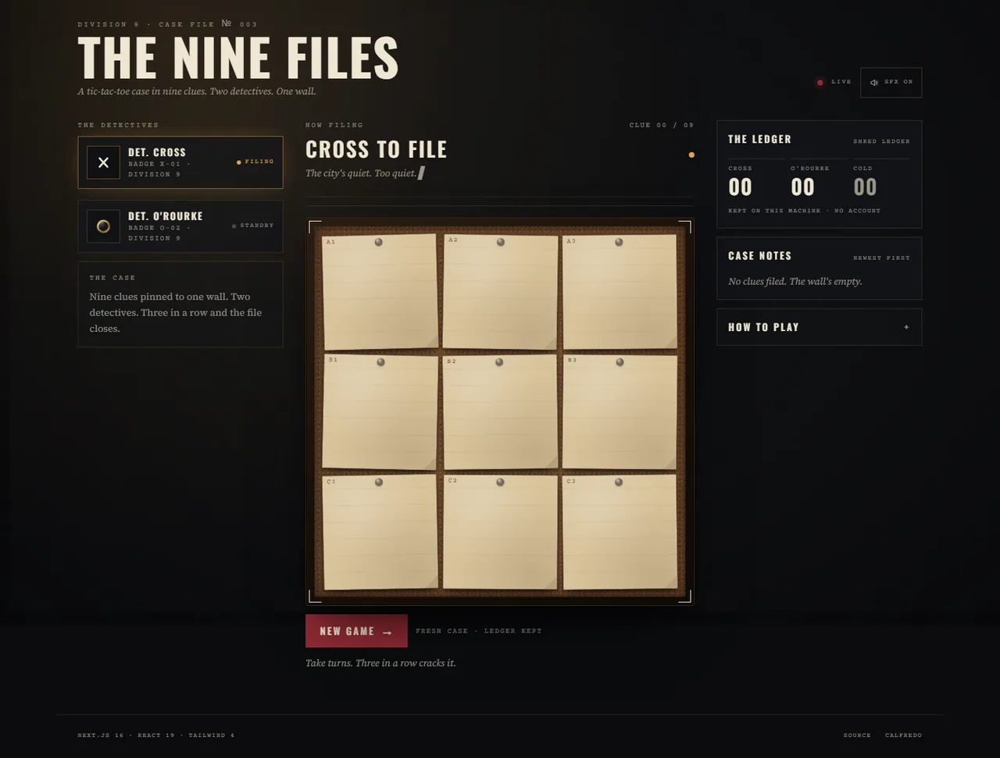
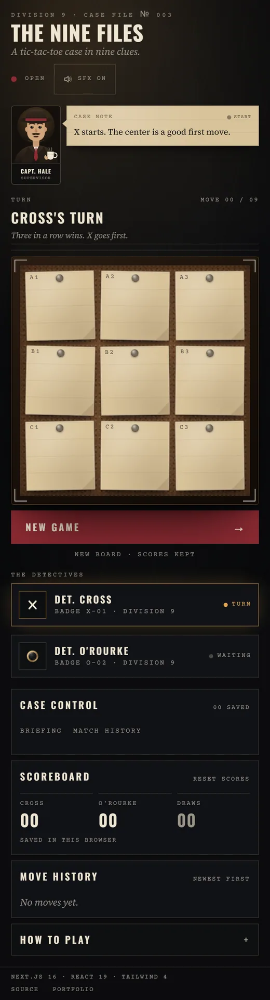

<div align="center">

# THE NINE FILES

### A tic-tac-toe case in nine clues.

Two detectives. Nine clues. Three in a row cracks the case.

[**Play the live game**](https://nine-files.vercel.app) · [Source](https://github.com/Calfredo23/nine-files)


</div>

## What this is

Built for the **SUpost / CapM junior React + Next.js application test**. The brief asks
for a working two-player tic-tac-toe on a public Vercel URL, and explicitly rewards
style and personality. This is the case-wall version.

- **Two players alternate.** Cross (X) and O'Rourke (O) claim clues on a nine-card board.
- **The result is explicit.** `CROSS WINS — CASE CLOSED`, `O'ROURKE WINS — CASE CLOSED`, or `DRAW — COLD CASE`.
- **New Game** clears the board and keeps the ledger.
- **The ledger** counts each detective's wins and cold cases, and survives a reload.
- **The rules are never hidden by the theme.** The cells show X and O, the button says NEW GAME, and the result says WINS or DRAW.

## The signature

The winning line is **red yarn** drawn pin-to-pin across the three claimed cards. A
taped **CASE CLOSED** label slams onto the board with a camera flash, the winner's ID
card is promoted, and the typewriter files the verdict. The board is a cork wall of
manila evidence cards, black pushpins, and a brass monocle for O. The palette is
charcoal, manila, tungsten, and oxblood; the type is Oswald, Source Serif 4, and
Courier Prime. Every texture is CSS or inline SVG — there are no image assets.

## Stack

| Layer | Choice |
|---|---|
| Framework | Next.js 16.4 (App Router, Turbopack, static export of the page) |
| UI | React 19.3, TypeScript strict |
| Styling | Tailwind CSS 4 with a small custom token layer |
| Motion | Motion 14 (`motion/react`) + CSS keyframes + one canvas burst |
| Tests | Vitest, Playwright, axe-core |
| Hosting | Vercel |

No backend, no accounts, no analytics, no cookies.

## Quality gates

| Gate | Result |
|---|---|
| Unit tests (Vitest) | **22 passing** — every win line, draw, illegal move, reset, commentary |
| E2E (Playwright) | **13 passing** — alternation, win, draw, New Game, persistence, keyboard, occupied cell |
| axe (WCAG 2.1 A/AA) | **0 violations** on the opening screen and after a win |
| Contrast (`scripts/contrast.mjs`) | Every measured pair passes |
| Lighthouse desktop | **99 performance · 100 accessibility · 100 best practices · 100 SEO** |
| Lighthouse mobile | **91 performance · 100 accessibility · 100 best practices · 100 SEO** |
| Production build | Static `/`, `/icon.svg`, `/opengraph-image`; no console errors |

Measured contrast (WCAG 2.x relative luminance):

| Pair | Ratio | Minimum |
|---|---|---|
| PAPER on INK | 15.77:1 | 4.5 |
| INK on MANILA | 11.36:1 | 4.5 |
| TUNGSTEN on INK | 9.02:1 | 4.5 |
| SMOKE on COAL | 6.07:1 | 4.5 |
| PAPER on OXBLOOD | 6.65:1 | 4.5 |
| COLD on MANILA | 5.45:1 | 4.5 |
| OXBLOOD on MANILA | 4.79:1 | 4.5 |
| MANILA on CORK | 4.53:1 | 3.0 (non-text) |

## Accessibility

- The board is a real `grid` / `row` / `gridcell` structure. Arrows move focus,
  Home/End jump, Enter or Space files a clue.
- Turns are announced politely; the verdict heading receives focus when the game ends.
- Focus rings are tungsten, 2px, never removed. Tap targets are at least 44px.
- `prefers-reduced-motion` removes the shake, flash, paper burst, grain drift, rain,
  lamp flicker, typewriter reveal, and spotlight.
- X and O differ by shape and material, not only colour.
- Sound is optional, labelled, and failure-safe; muting never blocks play.
- Measured at 360, 390, 768, and 1440 widths with no horizontal scroll.

## Run it

```bash
npm install
npm run dev          # http://localhost:3000
npm test             # unit
npm run test:e2e     # Playwright + axe + screenshots
npm run verify       # typecheck + lint + unit + build
```

The Playwright run builds and starts the production server on port 3211. Screenshots
land in `submission/screenshots/`.

## Structure

```
app/                 layout, page, metadata, OG image, icon, 404
components/          board, cells, marks, yarn, stamp, ledger, log, overlays
hooks/               ledger and sound preference via useSyncExternalStore
lib/                 pure game logic, commentary, storage, sound, client store
tests/unit/          Vitest
tests/e2e/           Playwright, axe, screenshot capture
scripts/             contrast measurement, WebP optimisation
docs/velitaxis/      project state and the design contract
```

## Decisions and limits

- **No AI opponent.** The brief asks for two players; the board stays unambiguous. The
  minimax "Oracle" mode is the next feature, not a hidden default.
- **Scores are local.** `localStorage` only; no account, no leaderboard, no PII.
- **The theme never owns the rules.** A reviewer can read X, O, NEW GAME, WINS, and DRAW
  without decoding the fiction.
- **Motion is bounded.** Transform/opacity only, particles capped at 44, reduced-motion
  path fully intact. Mobile TBT is 390ms; desktop is 100ms.
- **No third-party art.** All card, pin, monocle, texture, and grain work is CSS or SVG.

## Screenshots

| Desktop | Tablet |
|---|---|
|  |  |

| Mobile | Mobile win |
|---|---|
|  |  |

---

Built by **Cedrick Alfredo Catimbang** · [calfredo.is-pinoy.dev](https://calfredo.is-pinoy.dev)
